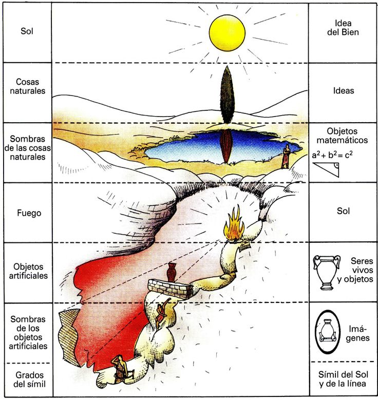
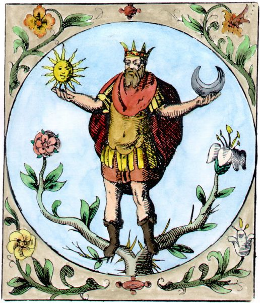
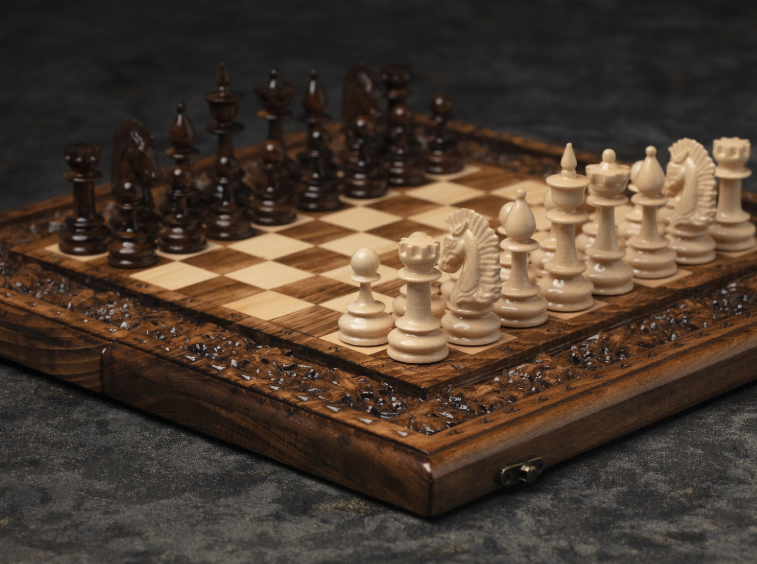
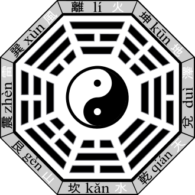
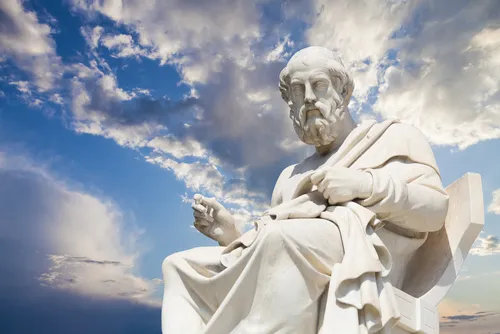
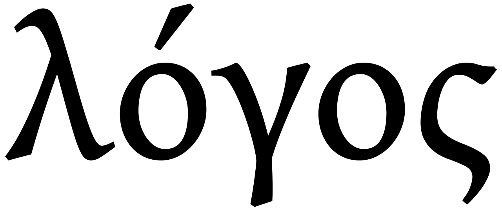
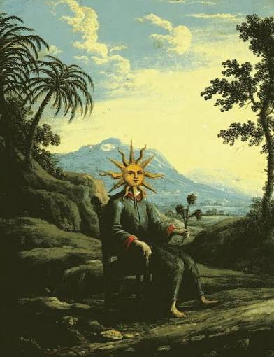
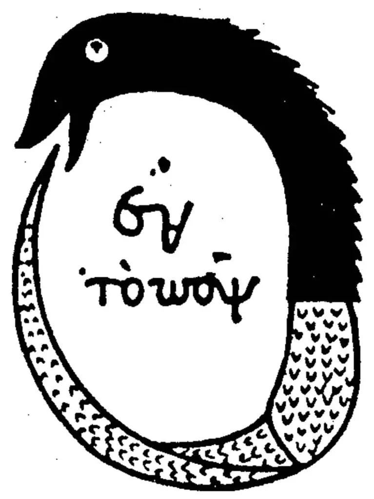

## Os 3 mundos

O universo por convenção se desdobra através de objetos menores que compõe objetos maiores, sistemas dentro de sistemas.  
A física clássica nada mais é do que a simplificação de um determinismo falso da física quântica, que é puramente probabilística e não-dualista.  
Nesse momento observamos que o menor com suas leis internas rege um maior, a estabilidade do maior se explica na relatividade do menor.  

Aqui com base na observação do universo, proponho a reflexão para falar de metafísica, que corresponde ao entendimento do universo além do objetivo e palpável, falar sobre o significado das coisas e da experiência empírica. Nesse sentido vamos tomar uma abordagem pé no chão em relação ao universo com um viés filosófico já estudado por diversas escolas.
Podemos dividir a experiência do Ser Humano consciente em 3 camadas:  
- A camada física e autônoma onde experienciamos os sentidos aristotélicos (os 5 sentidos) e onde as funções mais baixas de nossa existência acontecem, por baixa não tomemos por piores/inferiores, isso se refere ao sentido mais manifesto e objetivo de nossa existência.  
- A camada sentimental, a fronteira do vir a ser, é onde nossa coletânea de pensamentos, ações e percepções geram um movimento da necessidade de agir, que é a necessidade de levar algo a manifestação, através dos nossos sentidos levamos o recém-formado desejo ao objeto do desejo.  
- A camada mental, estando além do espaço e do tempo, são os conceitos e padrões que formam a realidade, os ciclos estáveis e simbólicos.

Do meu ponto de vista, é essencial que nenhuma vivência empírica ou filosófica possa ser incoerente com as descobertas cientificas até o momento, sou totalmente a favor de explorar a *psique* de maneira empírica e quebrar as barreiras do lento progresso cientifico ocidental humano, que vai aos trancos e barrancos conforme o interesse do capital. Mas é incoerente, ignorante e desrespeitoso dobrar leis conhecidas e profundamente estudadas, fundando uma pseudociência ou tentando explicar as coisas por um ponto de vista místico. 

## A União

Sendo assim, ao analisar a psique, devemos unir o chumbo ao éter, é imprescindível levar em conta a ciência.
Sendo assim a visão de padrões no universo deixa de ser real em dois momentos:
* Quando entramos a fundo na física quântica, devido a constante de Planck, a fluidez da realidade se quebra e tudo vira um tabuleiro de xadrez com partículas, existe apenas probabilidade com leis, até onde sabemos, a lei em si pode explicar padrões probabilísticos, porém é inerente ao sistema o não-determinismo.
* Quando observamos a realidade apenas por um ponto de vista espontâneo, curto e sem contexto, a aleatoriedade parece produto, quando na realidade é nossa falta de conhecimento sobre o meio que gera a percepção de aleatoriedade pois em razão da decoerência e da quebra do modelo de quântico em clássico, temos um sistema claramente determinista.
  
Lembrando que isso é somente o que sabemos, existem ainda muitas incógnitas.
Existem teorias que refutam a inexistência de um padrão, como a teoria da ordem implicada ou a teoria dos muitos mundos (ambas feitas por renomados cientistas), a física quântica observável continua sendo probabilística, nenhuma lei é quebrada, mas o que se intuí nessas teorias é que exista um substrato universal e interconectado.
 
## Os Padrões

Então para mim, o suprassumo do que tento alcançar ao leitor: A Teoria da irrazoabilidade matemática:
“Wigner observa que conceitos matemáticos puros que foram desenvolvidos e estudados independentemente da física, muitas vezes para que os matemáticos pudessem demonstrar sua "engenhosidade e senso de beleza formal", ainda assim encontram aplicações na física. A estrutura matemática da física teórica frequentemente aponta o caminho para novos avanços nessa teoria e tem poder preditivo e empírico na descrição da natureza.”  
  
Eis que a matemática pura e profunda pode explicar o quântico, padrões matemáticos que se aglomeram e se repetem e ecoam nos sistemas clássicos.
Quando aplicada à filosofia enxergo esses padrões orquestrados do menor ao maior, pelo conceito abstrato de ***Ideia***.  

Mergulhando mais profundamente: 
Existe a forte crença e intuição filosófica de que tudo quer servir a uma causa, as coisas possuem um conceito e uma finalidade. Qualquer vivência empírica profunda como a dos Iogues ou Santos tendem profundamente em seu Ser à conexão da realidade num plano unificado.

## A Realidade é um Paradoxo

A noção de que toda ideia quer vir a ser e é fortemente incentivada pelo universo que a permeia, se integrando simbioticamente ao meio.
Enxergo isso como mais que uma simples necessidade, é a tradução da própria lei da natureza, em que tudo se movimenta enquanto existir energia, as colisões e transformações são inevitáveis, não existe repouso absoluto. As coisas começam do nada, se transformam e ao nada retornam (I Ching).
 
Um padrão quer se materializar, um símbolo quer virar objeto, a imaginação quer virar ação. 

Resumindo, o universo pode ser considerado determinístico?    
Sim e não, num sentido macroscópico sim, podemos dizer que o universo é determinístico, pois os símbolos se repetem, nessa manifestação de leis estáveis, hoje mais do que tudo, se sabe que as leis nos permeiam por todos os campos.
Leis da física, leis da matemática, leis da biologia, tudo é formado de paredes e disso já sabemos, a questão é, o quanto conseguimos ampliar nosso ângulo de visão para enxergar o todo? Nesse momento não questionamos mais a obra, mas os detalhes da obra, descobrimos o número e estamos explorando as muitas casas decimais.  

A exploração cientifica seja ela empírica ou instrumentada é mais parecido um círculo que se aprofunda sobre um determinado aspecto que acaba se expandindo de dentro pra fora, do que um ponto determinado que chega a uma verdade absoluta.
Descobrir o universo e si-mesmo é sobre aproximação e profundidade, aquele que diz saber de tudo sobre algo, de nada sabe.
  
Num sentido epistêmico porém o universo não é determinista, tanto de um ponto de vista físico teórico quanto de um ponto de vista filosófico: Símbolos são não-criados, é sempre uma novidade como os símbolos se organizam e reorganizam. Como os elementos químicos da tabela periódica que tem uma numeração finita, porém os compostos químicos possíveis são infinitos, cada dia descoberto novos, mais complexos, mais difíceis de reproduzir e mais relevantes para nossa tecnologia. 

## Elasticidade e Solidificação

A **ideia** abstrata, assim como a física quântica, é por natureza não-dualista e relativística, totalmente elástica, enquanto a vivência objetiva e material: Ilusória, é determinista e dualista.

Precisamos de muitos graus de abstração para conseguirmos entender os fundamentos básicos da realidade, a física quântica para o não-estudante parece algo misterioso ou impossível.
Quanto mais nos aproximamos do cerne das coisas, mais percebemos que nosso ponto de vista polui e afeta o verdadeiro entendimento, e percebemos que não é possível analisar algo diretamente, sem um ponto de referência, inclusive isso é um dos grandes problemas da pesquisa de ponta. 

Quando tentamos ir em direção ao centro do foco de conhecimento e nos desfazemos o máximo possível das formas, nos atendo as abstrações, mais irreal as coisas soam para a mente humana. 
  
Assim como a partícula e a onda são verdadeiramente a mesma coisa e não podem ser especificadas de maneira realista, apenas pelo ponto de vista experimental/observacional. É impossível rotular uma ideia, um símbolo, podemos vestir o símbolo com uma forma, algo didático e bem conhecido que representa a função que conseguimos captar daquela ideia, mas nunca conseguimos isentar a forma de nosso ponto de vista, de nosso julgamento.  
É importante ressaltar que uma ideia sempre se renova, o modelo didático só vai até certo ponto e até onde se sabe, existem infinitas formas de se expressar uma única ideia.  

Deixando um pouco de lado a ciência e focamos mais na filosofia:
Para entendermos o símbolo e a ideia, precisamos ir além, precisamos estar abertos ao abstrato, ao não-entendimento, a dúvida, assim como os físico teóricos tem que fazer. Precisamos ser humildes e assumir que talvez não seja a ideia não-criada que seja abstrata, mas que nossa capacidade de entender seja limitada para captar algo tão abrangente e andrógeno.

## O Logos

Expandindo esse conceito dentro do Ser Humano, somos a ideia viva e encarnada, cada Ser Humano é por si só único, tem uma maneira única de entender, processar e viver. Consciente ou inconscientemente expressamos a ideia que somos, mesmo que não tenhamos a capacidade de ver através da membrana do lado de fora: O fluído universal, carregamos a ideia, sentimos a ideia que carregamos e materializamos aquilo que a ideia precisa ser. 
Logo se vê que a ação humana por si só é não-dualista também, independente de nosso julgar relativo de que estamos realizando algo construtivo ou destrutivo, a ideia apenas é, ela não se importa com o como, ela só quer se expressar. A diferença aqui é que podemos ser realistas e apenas observar o que a ideia é, ou construir um apego por um ângulo relativo da ideia e viver de uma ilusão, acreditando que nosso lado é o certo, quando sequer existem lados num círculo.

Existe uma essencialidade na busca pelo conhecimento, o conhecimento é um dos sentidos do espírito, sem conhecimento vivemos a esmo, podendo ser dito que é quase impossível "acertarmos na vida" se não observamos claramente o contexto ao nosso redor. O Caos e a Ordem interna estão diretamente atrelados ao nosso conhecimento. O mesmo nos dá capacidade de discernimento e leva a ação focalizada, quando se faz algo que se tem ampla noção de suas consequências.

Precisamos de um dicionário de vivências e formas, para que possamos localizar corretamente nossa ideia interna, se não valorizamos o conhecimento, acabamos por materializar e atrelar nossas ideias aos mais instintivos valores, só temos capacidade de entender aquilo que conhecemos, assim vinculamos nossas necessidades e aprendizados ao que é mais primitivo.

Aqui eu poderia estender um pouco sobre o sentimento, este é o retorno da opinião interna em relação ao viver, é a própria ideia julgando sua manifestação, essa manifestação que é puramente objetiva vive o sentimento que é subjetivo, o sentimento depende da compreensão dos fatores em torno da ação. Não existe ação sem sentimento, se não ouvimos o retorno de nossas ações e reações causados pelo nossos sentimentos, estamos cegos, incapazes de entender o mundo em que vivemos, pois o sentimento é a percepção da ideia.  
  
No processo entre o ser e o agir, ocorre a quebra da dualidade, e é isso que indica a qualidade da manifestação, ou ela de fato conversa diretamente com a ideia, uma manifestação de qualidade positiva, ou ela permeia, circula, evita ir ao centro da ideia, mas inevitavelmente manifesta a mesma finalidade, a manifestação de qualidade negativa. 
Perceba que a ideia independentemente gera no cosmos o movimento que precisava gerar, a ação só nos permite escolher a forma que a ideia vai ter.  
Ou vivemos um reino de ideias distorcidas, ou um paraíso de ideias claras e verdadeiras.  
## A existência autocontida
  
Dito tudo isso, temos o átomo da ideia, chegando no coração do nosso ensaio.
Independente do nome que você quiser chamar, símbolo, ideia, arquétipo, existe uma base abstrata para cada objeto sólido, e varias bases abstratas se somam com seu simbolismo, muitas vezes para o vir a ser de um objeto complexo.  
Assim como na química e física, acredito que o estudo dos símbolos, dos mitos, nos leve a compreensão do átomo relativístico que vai além da compreensão limitada que temos do presente sobre a consciência.  
  
Vamos além e delimitar algumas coisas:
Os universos, o universo dos efeitos (material), o universo sentimental e psíquico e o universo mental causal, são todos herméticos e fechados, eles próprios explicam a si mesmo, são auto-contidos e redundantes, você não precisa olhar além para encontrar a explicação para as coisas, a ciência pode viver só dentro da ciência, as coisas sempre vão ter causas circulares, tudo vai seguir as leis que geram a estabilidade.  

Porém aceitar a existência de múltiplas camadas em nossa consciência nos leva a expandir nossa capacidade de visão e nos enriquece imensamente no meio abstrato e compreensivo, fazendo nos tornar mais humanos, todas as vivências empíricas, instintivas ou esotéricas tem raízes em ceder voluntaria ou involuntariamente a existência não-objetiva e orgânica.
  
E assim, por mais hermético que cada universo seja, ainda existe algo que dá base a todos: A raiz da ideia, ela é imutável, sempre existiu, não há como alterar algo que não pode ser criado (pois não tem forma). 
Somos frutos das nossas ideias ou construímos nossas ideias com base num contexto complexo de ações e reações? Isso é um problema circular, diria que ambas as coisas.
O que importa é o enriquecimento da percepção: Quando paramos de enxergar o que cada coisa parece ser isoladamente, mas de fato caminhamos para ver o que cada coisa representa em seu papel no sistema inteiro, então podemos aplicar esse conhecimento a infinitos objetos, para enxergar essa matriz precisamos parar de preconceituar as coisas, sermos cabeça mais aberta.
Essa é a remoção do viés, é a entrega a pura observação, se afastando do apego ao resultado.

Nesse momento ocorre um nascimento, um trovão! Do positivo e negativo, surge um terceiro, o neutro, que é o que realmente é. 
Esse é o ponto de vista essencial, pois quando aplicado diariamente e em massa, nos afasta dos sofrimentos, dos julgamentos e de egoísmo.  
Acelerei um pouco aqui né? Mas nesse ponto deixo para fins de reflexão, a cada um, se pergunte, por que me afastar do viés me torna mais vivo? Mais humano?

Se todas as coisas podem ser representadas através de ideias previamente (e eternamente) contidas por símbolos, então, podemos de certa forma, determinar a manifestação das ideias, se conhecemos seus símbolos.  
Porém quando me refiro a determinar, não é um determinismo certeiro e científico, isso paradoxal a ideia, pois a ideia é por natureza, relativística e não-formada, assim como os próprios pilares do universo.

Do símbolo da ideia podemos derivar o conteúdo não-dualista, que é justamente o conteúdo utilizado pelo sentimento para formar a vontade do manifestar.  
Compreender o símbolo é compreender a finalidade dos movimentos. Compreender seu próprio sentimento é observar a reação causada pela ação, e entender que por bem ou por mal, aquilo leva a um resultado.
Ao invés de julgar a qualidade da ação ou os objetos envolvidos no resultado, passamos a enxergar a orquestra inteira.  

## O Círculo

Buscar entender o símbolo é trocar as perguntas que fazemos: “Como, Por que?” para “Para quê?”, é assentir que o mundo em que vivemos é cheio de sentido e finalidade e não existe nada que acontece sem objetivo, sem causa e efeito, sem representar algo maior.

Só é importante ressaltar, jamais podemos entender totalmente a ideia, não somos capazes de ser donos do símbolo, personificar ou buscar se tornar o símbolo é um erro e pode levar a consequências graves, o Ser é um composto plural, vivemos e somos vividos. 
Somos muitos átomos, muitos símbolos, mas podemos exercer a busca pelo entendimento de cada símbolo individual que leva a uma aproximação e soma de cada vez mais ângulos de visão. A criação de uma interface de acesso (única a sua própria ideia interna) leva ao desenvolvimento da sua própria identidade.

Essa visão de dar sentido ao mundo e a vida, constrói a verdadeira espiritualidade, o ritual, a magia, a oração, as formas que damos a existência empírica, nada mais são do que instrumentos e ferramentas, mas para nos tornarmos humanos precisamos entender, expandir, iluminar, sem pré-conceitos e de maneira orgânica.
Espiritualidade é dar sentido ao mundo, é enxergar o Universo refletido em si mesmo, tudo que apresentei aqui foi uma observação de como podemos tomar a própria matriz básica da realidade como ensinamento interior.

Aquele que sabe de verdade, cria leis internas e valores para não atrapalhar esse fluxo de matrizes interligadas, pois o Ser não escapa às leis da ação e reação, se quisermos ter uma vida plena e feliz precisamos pertencer ao fluxo e não vivermos no Caos.

*(Esse texto foi criado sem uso de IA.)*